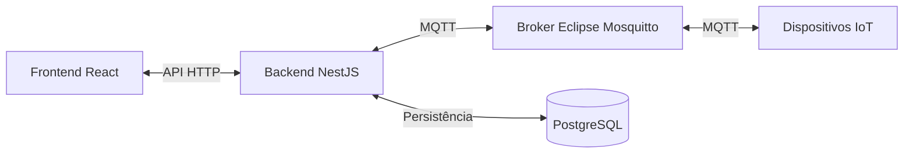

# Plano de implementação do projeto IoT

## 1. Objetivo

Construir uma aplicação IoT para monitoramento da água de uma caixa d’água, com interface web, backend e comunicação com dispositivos por meio do protocolo MQTT.

Nesta primeira etapa, o foco será a interface de comunicação: integração entre backend, broker MQTT e frontend. O desenvolvimento do firmware do dispositivo IoT em C++ ficará para uma etapa posterior.

Este documento será atualizado conforme definirmos os requisitos e as etapas de implementação do projeto.

## 2. Arquitetura inicial

| Componente | Tecnologia | Responsabilidade |
| --- | --- | --- |
| Frontend | React | Realizar login, exibir os dados recebidos do backend e chamar a rota de enchimento. |
| Backend | NestJS | Implementar a API, a autenticação, a identificação dos dispositivos e a integração com o broker MQTT. |
| Broker MQTT | Eclipse Mosquitto | Receber e distribuir mensagens MQTT entre os dispositivos IoT e o backend. |
| Banco de dados | PostgreSQL | Persistir os usuários e os demais dados definidos para o sistema. |
| Conteinerização | Docker | Padronizar a execução dos serviços e facilitar o deploy. |

O Eclipse Mosquitto é um broker MQTT de código aberto.

## 3. Comunicação entre os componentes

O frontend se comunicará com o backend por uma API. O backend se conectará ao Mosquitto para publicar e receber mensagens dos dispositivos IoT.

O escopo do frontend se limita a três funções:

1. Realizar o login do usuário.
2. Consultar e exibir os dados disponibilizados pelo backend.
3. Chamar a rota de enchimento do backend ao acionar “Encher caixa”.

Toda a comunicação MQTT ficará no backend, que encaminhará a solicitação de enchimento ao dispositivo IoT. O caminho e o método HTTP dessa rota serão definidos no contrato da API.

O backend será responsável por integrar a comunicação MQTT com os dados disponibilizados ao frontend e por acessar o PostgreSQL.

Também manterá os dados necessários para identificar e reconhecer cada dispositivo e associar suas mensagens aos tópicos MQTT correspondentes. Os campos de identificação e a configuração de acesso serão definidos no contrato de comunicação.

## 4. Execução e deploy

- Utilizar Docker para executar os componentes em contêineres separados.
- Utilizar Docker Compose para organizar e iniciar os serviços do projeto em conjunto.
- Incluir uma instância pequena de PostgreSQL no ambiente Docker, com volume para persistência dos dados.
- Definir as configurações de rede, portas, variáveis de ambiente e persistência durante a implementação.

## 5. Autenticação e armazenamento de senhas

- Implementar autenticação via JWT no backend NestJS.
- Permitir que o frontend autentique o usuário e utilize o token nas requisições às rotas protegidas.
- Armazenar no PostgreSQL apenas o hash da senha, nunca a senha em texto puro.
- Utilizar um algoritmo apropriado para hash de senhas, com salt; a escolha será detalhada na implementação.
- Definir posteriormente a validade dos tokens e o fluxo de renovação de sessão.

## 6. Monitoramento e comando de enchimento

O dispositivo IoT utilizará os sensores de nível inferior e superior para determinar o estado da caixa. A interpretação das leituras, a autorização física para encher e as proteções de segurança serão responsabilidade do próprio dispositivo, com base nos sensores.

O frontend exibirá os valores dos sensores e os estados informados pelo dispositivo, como caixa vazia, cheia e disponibilidade para enchimento. O backend e o frontend não calcularão esses estados a partir de combinações de sensores nem definirão regras de segurança do enchimento.

O formato dos valores e estados publicados será definido no contrato MQTT, sem presumir volume ou porcentagem que o dispositivo não informe.

### Opção “Encher caixa”

- Disponibilizar uma ação no frontend que apenas chame a rota de enchimento do backend para solicitar o enchimento ao IoT.
- Apresentar a disponibilidade de enchimento conforme informada pelo dispositivo.
- O frontend enviará a solicitação ao backend autenticado, que verificará a permissão do usuário e a identificação do dispositivo de destino e encaminhará o comando pelo broker MQTT.
- O dispositivo decidirá se pode executar o comando com base nos sensores e nas suas regras de segurança, e informará a aceitação ou rejeição e o estado do enchimento pelo broker.
- Exibir separadamente a solicitação enviada e a confirmação de que o enchimento foi iniciado; o envio do comando não confirma o acionamento físico.
- O início, a interrupção e as proteções do enchimento serão controlados localmente pelo dispositivo; sua segurança não dependerá do backend, do frontend ou da conexão MQTT.
- Exibir os estados de falha e de comunicação informados ou identificados pela integração, sem substituir as decisões locais do dispositivo.

### Fluxo MQTT

1. O dispositivo publica sua identificação, os valores dos sensores e os estados que determina no Mosquitto.
2. O backend recebe as leituras e disponibiliza o estado da caixa ao frontend.
3. O usuário solicita “Encher caixa” no frontend.
4. O backend verifica a autenticação, a permissão de acesso e o dispositivo de destino e publica o comando no tópico correspondente do Mosquitto.
5. O dispositivo avalia o comando localmente e publica a aceitação ou rejeição e as atualizações do enchimento.

Na primeira etapa, as leituras e as confirmações do dispositivo serão simuladas para validar esse fluxo sem desenvolver o firmware C++.

## 7. Escopo inicial de implementação

- Estruturar os serviços Docker do frontend, backend, Mosquitto e PostgreSQL.
- Implementar a persistência de usuários e a autenticação JWT.
- Definir o contrato de comunicação MQTT e conectar o backend ao broker.
- Estruturar os dados de identificação dos dispositivos e sua associação às mensagens e aos tópicos MQTT.
- Implementar a API e a interface web para apresentar as informações de monitoramento da caixa d’água.
- Exibir os dois sensores, o estado da caixa e a ação “Encher caixa”, com retorno do andamento do comando.
- Validar a comunicação com mensagens MQTT simuladas antes da integração com o dispositivo físico.
- Desenvolver o firmware em C++ em uma etapa posterior.

## 8. Próximas definições

- Definir os modelos dos sensores e o dispositivo IoT envolvido.
- Documentar os estados e as decisões de enchimento que o dispositivo comunicará ao sistema.
- Definir, na etapa do firmware, o acionamento físico (bomba ou válvula) e as regras locais de segurança, parada e falha.
- Definir o prazo para considerar uma leitura desatualizada e o tempo de espera pela confirmação de um comando.
- Definir os tópicos MQTT e o formato das mensagens.
- Definir as permissões dos usuários e os requisitos de autenticação e acesso ao broker.
- Definir quais dados de monitoramento serão persistidos no PostgreSQL.
- Definir como o frontend receberá as atualizações de monitoramento do backend.
- Detalhar as etapas de implementação do frontend, backend e infraestrutura Docker.
