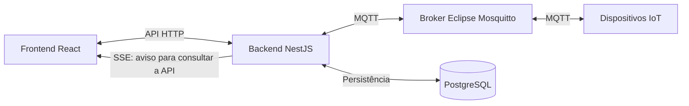

# Plano de implementação do projeto IoT

## 1. Objetivo

Construir uma aplicação IoT para monitoramento da água de uma caixa d’água, com interface web, backend e comunicação com dispositivos por meio do protocolo MQTT.

Nesta primeira etapa, o foco será a interface de comunicação: integração entre backend, broker MQTT e frontend. O desenvolvimento do firmware do dispositivo IoT em C++ ficará para uma etapa posterior.

Este documento será atualizado conforme definirmos os requisitos e as etapas de implementação do projeto.

## 2. Arquitetura inicial

| Componente | Tecnologia | Responsabilidade |
| --- | --- | --- |
| Frontend | React | Realizar login, exibir os dados recebidos do backend e chamar a rota de enchimento. |
| Backend | NestJS | Implementar a API, a autenticação, a identificação dos dispositivos e a integração com o broker MQTT. |
| Broker MQTT | Eclipse Mosquitto | Receber e distribuir mensagens MQTT entre os dispositivos IoT e o backend. |
| Banco de dados | PostgreSQL | Persistir usuários, dispositivos e o histórico de todas as comunicações MQTT com timestamps. |
| Entrada web | Nginx | Servir o build React e encaminhar API e SSE para o NestJS via HTTPS. |
| Conteinerização | Docker | Padronizar a execução dos serviços e facilitar o deploy. |

O Eclipse Mosquitto é um broker MQTT de código aberto.

## 3. Comunicação entre os componentes



O frontend se comunicará com o backend por uma API. O backend se conectará ao Mosquitto para publicar e receber mensagens dos dispositivos IoT.

O escopo do frontend se limita a três funções:

1. Realizar o login do usuário.
2. Consultar e exibir os dados disponibilizados pelo backend.
3. Chamar a rota de enchimento do backend ao acionar “Encher caixa”.

Toda a comunicação MQTT ficará no backend, que encaminhará a solicitação de enchimento ao dispositivo IoT. A rota proposta é `POST /dispositivos/:deviceId/encher`, protegida por JWT e sem duração no corpo: o tempo de enchimento será uma configuração local do IoT. A resposta HTTP indicará o encaminhamento da solicitação, sem confirmar o acionamento da bomba.

O backend será responsável por integrar a comunicação MQTT com os dados disponibilizados ao frontend e por acessar o PostgreSQL.

Também manterá os dados necessários para identificar e reconhecer cada dispositivo e associar suas mensagens aos tópicos MQTT correspondentes. No MVP haverá apenas um dispositivo, identificado pela variável de ambiente `IOT_DEVICE_ID` do backend e usado nos tópicos e nas mensagens. Não haverá cadastro ou vinculação de múltiplos dispositivos por usuário. Os usuários autenticados acessarão esse dispositivo único. As credenciais MQTT e as permissões de acesso aos tópicos serão próprias do dispositivo; o JWT do usuário será utilizado apenas na API HTTP.

## 4. Execução e deploy

- Utilizar Docker para executar os componentes em contêineres separados.
- Utilizar Docker Compose para organizar e iniciar os serviços do projeto em conjunto.
- Hospedar em servidor próprio, mantendo frontend, backend, Mosquitto e PostgreSQL em Docker.
- Não implementar backups neste MVP; volumes persistentes continuam necessários e não equivalem a backup.
- Incluir uma instância pequena de PostgreSQL no ambiente Docker, com volume para persistência dos dados.
- Definir as configurações de rede, portas, variáveis de ambiente e persistência durante a implementação.

### 4.1. Organização no servidor

Executar os seguintes serviços no Docker Compose:

| Serviço | Função | Acesso externo |
| --- | --- | --- |
| `web` (Nginx) | Servir os arquivos compilados do React, terminar HTTPS e encaminhar `/api/` ao backend, incluindo SSE | TCP 80 e 443 |
| `backend` (NestJS) | API, SSE e integração MQTT | Sem porta pública; acessado pelo Nginx na rede Docker |
| `mosquitto` | Broker MQTT e autenticação do IoT | TCP 8883 com TLS para o dispositivo |
| `postgres` | Usuários e histórico | Sem porta pública; acessado pelo backend na rede Docker |

O Nginx ficará no contêiner `web`, que também contém o build do frontend. Não será necessário instalar Nginx diretamente no sistema do servidor nem executar o servidor de desenvolvimento React em produção. O host precisará de Docker Engine, Compose e das configurações de DNS, firewall e acesso administrativo.

### 4.2. Domínio e entradas públicas

Usar nomes ilustrativos até a definição do domínio real:

- `app.seudominio.com`: registro DNS apontando para o IP público do servidor.
- `mqtt.seudominio.com`: registro DNS apontando para o mesmo IP, permitindo conexão MQTT TCP direta, sem exigir um proxy HTTP.
- `https://app.seudominio.com/`: interface React, com fallback para `index.html` nas rotas da aplicação.
- `https://app.seudominio.com/api/`: API NestJS; o proxy removerá o prefixo `/api` antes de encaminhar às rotas internas já descritas neste plano.
- A rota SSE ficará sob `/api/` e passará pelo mesmo Nginx.
- `mqtts://mqtt.seudominio.com:8883`: conexão do IoT diretamente ao listener TLS do Mosquitto, com usuário e senha próprios.

DNS aponta nomes para endereços; os caminhos HTTP são tratados pelo Nginx e as portas identificam os serviços. MQTT TCP não será publicado como uma rota HTTP `/mqtt`. Se houver um serviço de proxy no provedor de DNS, o nome MQTT deverá permitir TCP direto ao servidor.

Liberar TCP 80 (redirecionamento para HTTPS e validação de certificado, quando aplicável), 443 (web/API/SSE) e 8883 (MQTT TLS) no firewall e nas publicações Docker. Não publicar PostgreSQL nem a porta da API diretamente na internet. Acesso SSH permanece uma configuração administrativa do host.

O backend poderá usar `mqtt://mosquitto:1883` exclusivamente na rede interna Docker, com autenticação e ACL, sem publicação dessa porta no host. Configurar os controles de acesso também nesse listener interno. O dispositivo externo usará o listener 8883 com TLS.

### 4.3. Certificados, SSE e configuração

- Emitir e renovar certificados válidos para os nomes web e MQTT; montar certificados e chaves nos serviços que os utilizam. Definir o mecanismo automatizado de emissão, renovação e recarga dos serviços na implementação.
- No proxy SSE, desabilitar buffering e cache, ajustar o timeout de leitura e manter a conexão ativa com heartbeats do backend. Esses heartbeats SSE não determinam a frequência de publicação do IoT.
- Manter a configuração do backend e as senhas em arquivo `.env` privado no servidor, fora do Git, com `.env.example` contendo apenas nomes e exemplos sem segredos. Variáveis usadas no build React são públicas: nenhuma senha irá para elas.
- Manter o arquivo de senhas e as ACLs do Mosquitto em arquivos privados montados no contêiner. Alterar a senha no `.env` não atualiza automaticamente o arquivo de autenticação do broker: ambos devem ser provisionados de forma consistente.
- Configurar as credenciais próprias do dispositivo na etapa do firmware; a forma de armazenamento depende da plataforma e não exige suporte a um arquivo `.env` literal.

Referências: [proxy HTTP do Nginx](https://nginx.org/en/docs/http/ngx_http_proxy_module.html) e [listeners e TLS do Mosquitto](https://mosquitto.org/man/mosquitto-conf-5.html).

## 5. Autenticação e armazenamento de senhas

- Implementar autenticação via JWT no backend NestJS.
- Permitir que o frontend autentique o usuário e utilize o token nas requisições às rotas protegidas.
- Armazenar no PostgreSQL apenas o hash da senha, nunca a senha em texto puro.
- Utilizar `bcryptjs` para gerar e verificar o hash das senhas, com salt.
- O JWT terá validade de 4 horas. O armazenamento do token e a renovação de sessão ainda serão detalhados.
- Os usuários serão mantidos no banco, sem tela de cadastro no frontend. O primeiro usuário será criado por uma rota de inicialização que gera o hash com `bcryptjs` e persiste o registro.
- A rota de inicialização só poderá ser utilizada enquanto não houver usuários, com acesso restrito por segredo de configuração; detalhes de caminho e execução serão definidos na implementação. Inserções manuais posteriores também deverão conter apenas hashes, nunca senhas em texto puro.

## 6. Funcionamento do dispositivo e responsabilidades

O hardware atual terá **um sensor de nível de água e uma bomba**. Esta definição substitui a proposta anterior de sensores inferior e superior.

- Sensor ativo: há água no ponto onde o sensor está instalado.
- Sensor inativo: não há água nesse ponto.
- Ao detectar a transição para ausência de água, o IoT inicia um ciclo automático: liga a bomba pelo tempo configurado e depois a desliga.
- O tempo será contado localmente pelo dispositivo. O término do tempo desliga a bomba mesmo sem conexão com o backend ou com o broker.
- O comportamento ao iniciar sem água, as tentativas adicionais, a parada antecipada e a permissão de enchimento serão definidos no firmware do IoT com base nos sensores. Essas decisões não são pendências para implementar o frontend e o backend.

### Significado dos estados exibidos

Um único sensor não mede volume nem porcentagem e não comprova que toda a caixa está cheia ou vazia. O contrato representará `com_agua` e `sem_agua` **no ponto do sensor**. A interface usará “Água no sensor” e “Sem água no sensor”. O uso dos rótulos “Cheia” e “Vazia” dependerá de confirmar a posição do sensor e o significado desejado.

“Enchendo” será o estado do ciclo de enchimento informado pelo IoT, separado da leitura do sensor. Ao terminar o tempo, o ciclo pode estar concluído e ainda haver ausência de água no sensor; o sistema não converterá conclusão em “caixa cheia”.

### Opção “Encher caixa”

1. O frontend chama a rota autenticada de enchimento.
2. O backend verifica o acesso do usuário ao dispositivo e encaminha o comando pelo MQTT.
3. O IoT decide localmente se aceita o comando e aplica o mesmo ciclo temporizado usado pelo acionamento automático.
4. O IoT informa a aceitação ou rejeição e publica as mudanças de estado.

O frontend apenas apresenta os dados e o retorno da solicitação. O backend não decide se o nível de água permite encher: encaminha o pedido e aguarda a resposta do IoT. A validação de autenticação, acesso e comunicação permanece no backend. As regras físicas de acionamento e segurança pertencem ao IoT. Um comando recebido durante um ciclo em andamento não reinicia nem prolonga o temporizador.

O estado da bomba informado pelo firmware representa o acionamento da saída de controle. Sem um sensor adicional de retorno, ele não comprova funcionamento mecânico nem fluxo de água.

## 7. Contrato MQTT proposto — versão 1

As definições abaixo são o contrato planejado para implementar o backend e o simulador antes do firmware C++. As mensagens serão JSON em UTF-8; os tipos TypeScript documentam o formato, e o backend deverá validar os dados em tempo de execução.

### 7.1. Identificação e tópicos

O `deviceId` será estável, único e restrito a letras, números, hífen e sublinhado, sem curingas ou separadores MQTT. O identificador do payload deverá corresponder ao identificador do tópico e ao cadastro autorizado no backend.

| Tópico | Publicador → consumidor | Finalidade | QoS | Retain |
| --- | --- | --- | --- | --- |
| `iot/v1/dispositivos/{deviceId}/estado` | IoT → backend | Último retrato completo do dispositivo | 1 | Sim |
| `iot/v1/dispositivos/{deviceId}/disponibilidade` | IoT/broker → backend | Conectado ou desconectado | 1 | Sim |
| `iot/v1/dispositivos/{deviceId}/comandos` | Backend → IoT | Solicitação de enchimento | 1 | Não |
| `iot/v1/dispositivos/{deviceId}/respostas` | IoT → backend | Aceitação ou rejeição do comando | 1 | Não |

O dispositivo configurará uma mensagem de última vontade (LWT) `offline` e publicará `online` ao conectar. A presença MQTT e a atualização das leituras são informações diferentes: o backend também verificará há quanto tempo recebeu o último estado.

### 7.2. Estado publicado pelo IoT

```typescript
type NivelAgua = 'com_agua' | 'sem_agua' | 'desconhecido';
type StatusBomba = 'ligada' | 'desligada' | 'desconhecido';
type StatusEnchimento = 'parado' | 'enchendo' | 'concluido' | 'falha';
type OrigemEnchimento = 'automatico' | 'manual';

interface EstadoDispositivoV1 {
  schemaVersion: 1;
  deviceId: string;
  bootId: string; // Novo identificador a cada inicialização.
  sequence: number; // Inteiro crescente dentro do mesmo bootId.
  uptimeMs: number; // Inteiro não negativo desde a inicialização.
  sensor: {
    ativo: boolean | null; // null = leitura ainda indisponível.
    nivel: NivelAgua;
  };
  bomba: {
    status: StatusBomba;
  };
  enchimento: {
    status: StatusEnchimento;
    cicloId: string | null;
    origem: OrigemEnchimento | null;
    commandId: string | null; // Preenchido somente para origem manual.
    duracaoConfiguradaSegundos: number; // Inteiro positivo, definido no IoT.
    tempoRestanteSegundos: number; // Inteiro entre 0 e a duração configurada.
  };
  falha: {
    codigo: 'LEITURA_SENSOR_INVALIDA' | 'TEMPO_ENCHIMENTO_INVALIDO' | 'FALHA_INTERNA';
    mensagem: string;
  } | null;
}
```

Regras do payload:

- `ativo: true` corresponde a `com_agua`; `false`, a `sem_agua`; `null`, a `desconhecido`. A conversão do sinal elétrico será feita no firmware.
- `enchendo` exige bomba `ligada`, ciclo identificado, origem definida e tempo restante positivo.
- Fora de `enchendo`, o tempo restante será zero e a bomba estará desligada ou com estado desconhecido.
- Antes do primeiro ciclo, usar `parado`, com `cicloId`, `origem` e `commandId` nulos. Ao concluir, manter a identificação do último ciclo até o próximo ciclo ou reinício.
- Ciclos automáticos terão `commandId: null`. Ciclos manuais usarão o identificador do comando aceito.
- `falha` no enchimento exige detalhes no campo `falha`. Não inferir defeito mecânico ou falta de fluxo sem hardware capaz de detectar isso.
- A frequência e os momentos de publicação serão definidos pelo IoT. O backend receberá e registrará as mensagens conforme chegarem, sem impor um intervalo de envio ao dispositivo.
- Usar `bootId` e `sequence` para descartar duplicatas e estados antigos da mesma inicialização. Uma nova sessão deverá ser reconciliada com a disponibilidade e um estado atualizado do dispositivo.
- O backend registrará `receivedAt` em UTC ao receber a mensagem. O contrato não exige relógio sincronizado no IoT; uma mensagem retida recebida após reconexão não comprova leitura atual.

Exemplo durante um ciclo automático — os 10 segundos são ilustrativos, não uma duração aprovada:

```json
{
  "schemaVersion": 1,
  "deviceId": "caixa-001",
  "bootId": "boot-a1",
  "sequence": 12,
  "uptimeMs": 45000,
  "sensor": { "ativo": false, "nivel": "sem_agua" },
  "bomba": { "status": "ligada" },
  "enchimento": {
    "status": "enchendo",
    "cicloId": "boot-a1-ciclo-1",
    "origem": "automatico",
    "commandId": null,
    "duracaoConfiguradaSegundos": 10,
    "tempoRestanteSegundos": 7
  },
  "falha": null
}
```

### 7.3. Disponibilidade

```typescript
interface DisponibilidadeV1 {
  schemaVersion: 1;
  deviceId: string;
  bootId: string;
  status: 'online' | 'offline';
}
```

A LWT usará o mesmo formato com `offline`. O backend exibirá desconexão ou dados desatualizados separadamente do último nível conhecido; desconexão não significa caixa vazia nem bomba desligada.

### 7.4. Comando enviado pelo backend

```typescript
interface ComandoEncherV1 {
  schemaVersion: 1;
  deviceId: string;
  commandId: string; // UUID gerado pelo backend.
  targetBootId: string; // Inicialização atual conhecida do dispositivo.
  tipo: 'encher';
}
```

O comando não define tempo nem força a bomba a ligar. O IoT utiliza sua configuração local e suas condições de execução.

- Encaminhar comandos apenas para uma sessão online com estado atualizado.
- Não reter, não enfileirar para um dispositivo offline e não reenviar automaticamente após reconexão. Configurar a sessão de assinatura de comandos sem persistência entre conexões.
- O IoT rejeitará um `targetBootId` diferente de sua inicialização atual.
- QoS 1 pode gerar duplicatas: o IoT deverá reconhecer `commandId` repetido e devolver o resultado anterior, sem executar um novo ciclo nem reiniciar o temporizador. A retenção desses identificadores será definida na implementação.
- O backend registrará o comando como pendente até receber a resposta. Na ausência de resposta dentro do prazo, exibirá resultado desconhecido/tempo esgotado, sem presumir que a bomba permaneceu desligada e sem reenviar o comando automaticamente.

### 7.5. Resposta do IoT ao comando

```typescript
interface BaseRespostaV1 {
  schemaVersion: 1;
  deviceId: string;
  bootId: string;
  commandId: string;
}

type RespostaComandoV1 = BaseRespostaV1 & (
  | { status: 'aceito'; cicloId: string }
  | {
      status: 'rejeitado';
      motivo:
        | 'JA_ENCHENDO'
        | 'ENCHIMENTO_NAO_PERMITIDO'
        | 'DISPOSITIVO_EM_FALHA'
        | 'SESSAO_INVALIDA'
        | 'COMANDO_INVALIDO';
    }
);
```

A resposta correlaciona a solicitação pelo `commandId`. `aceito` confirma a aceitação local; o início e a conclusão serão acompanhados pelo tópico de estado com o mesmo `cicloId`. A decisão de permitir enchimento, inclusive com água já presente, pertence ao IoT. O sistema deve suportar tanto `aceito` quanto `rejeitado`, sem reproduzir essa decisão a partir da leitura do sensor.

As credenciais e ACLs do Mosquitto deverão permitir que cada IoT publique apenas seu estado, disponibilidade e respostas, e assine apenas seus comandos. O backend terá as permissões necessárias para integrar os dispositivos autorizados. Senhas, tokens e credenciais não serão enviados nos payloads de telemetria.

### 7.6. Credenciais MQTT do MVP

Utilizar duas contas independentes no Mosquitto, com senhas distintas, configuradas no ambiente do backend e no dispositivo:

- `backend`: publica comandos e lê estado, disponibilidade e respostas do dispositivo configurado.
- `iot-caixa`: publica estado, disponibilidade e respostas e lê apenas seus comandos.

O broker autenticará essas conexões com um arquivo de senhas gerado por `mosquitto_passwd`, montado no contêiner, e restringirá os tópicos por ACL. Desabilitar conexões anônimas. O formato desse arquivo é gerenciado pelo Mosquitto e não será gerado com `bcryptjs`.

O backend receberá `MQTT_URL`, `MQTT_USERNAME`, `MQTT_PASSWORD` e `IOT_DEVICE_ID` por configuração de ambiente. O IoT receberá o endereço do broker, suas próprias credenciais e o mesmo identificador de dispositivo na etapa de configuração do firmware. Cada cliente terá um `clientId` diferente, que identifica a conexão, mas não substitui a senha.

Essas credenciais não são os usuários do PostgreSQL nem o JWT do frontend. Não versionar senhas no repositório nem expor credenciais MQTT ao navegador. Para acesso MQTT pela internet, prever TLS; a configuração de rede e certificados ainda será detalhada para o servidor próprio.

Referência: [autenticação do Mosquitto](https://mosquitto.org/documentation/authentication-methods/).

## 8. Histórico das comunicações e atualização da tela

### 8.1. Persistência no PostgreSQL

O frontend exibirá apenas o status atual e seu horário nesta etapa, sem tela de histórico.

Guardar o histórico de todas as comunicações MQTT observadas pelo backend: estados, disponibilidade, comandos enviados e respostas recebidas. O histórico não ficará limitado ao último estado; não haverá descarte automático de registros no escopo inicial.

Para cada comunicação, registrar:

- Identificador único do registro e `deviceId` associado, quando reconhecido.
- Direção (`recebida` ou `enviada`), tópico, payload original e tipo da mensagem.
- Timestamp UTC de recebimento (`receivedAt`) para mensagens recebidas, ou de publicação (`publishedAt`) para mensagens enviadas.
- `bootId`, `sequence`, `commandId` e `cicloId`, quando presentes, para correlação.
- Indicadores de mensagem retida, QoS e resultado da validação, quando aplicáveis.
- Resultado da tentativa de publicação de um comando, distinguindo envio, falha de envio e resposta do dispositivo.

O timestamp do backend informa quando ele observou ou enviou a mensagem, sem presumir que seja o instante da leitura física. Caso o IoT passe a fornecer um timestamp de origem, ele também será armazenado, preservando o timestamp de recebimento. O contrato atual mantém `uptimeMs` e não exige relógio sincronizado no dispositivo.

Mensagens duplicadas e inválidas também serão registradas; apenas mensagens válidas e aplicáveis atualizarão o estado atual. A deduplicação impedirá reaplicação de eventos, sem apagar o registro das comunicações recebidas.

O histórico cobre as mensagens efetivamente observadas ou enviadas pelo backend. Mensagens que não chegarem durante uma desconexão só poderão ser recuperadas se houver suporte de entrega ou armazenamento na integração; não presumir que o MQTT retido represente um histórico completo.

### 8.2. Status atual e horário

A interface sempre exibirá o último status conhecido, acompanhado do timestamp correspondente. Uma solicitação nova não apagará o estado atual nem fará a tela presumir que a bomba ligou. As respostas de aceitação ou rejeição serão persistidas e exibidas com seus horários, sem substituir indevidamente a telemetria da bomba.

Como o contrato atual não exige relógio sincronizado no IoT, o horário exibido será identificado como “Recebido em”, usando `receivedAt`. O instante em que o status foi gerado no dispositivo só poderá ser apresentado como tal se o IoT fornecer um timestamp de origem confiável; isso permanece uma definição do contrato com o firmware.

A ausência de resposta não inventará um novo estado da bomba: a tela continuará exibindo o último status e seu horário, diferenciando a situação da solicitação. Alterações nas respostas dos comandos também provocarão aviso SSE após persistência.

### 8.3. SSE como aviso de atualização

O SSE será utilizado para avisar o frontend de que existem dados novos. Os dados completos continuarão sendo consultados pela API HTTP.

1. Ao entrar na tela, o frontend estabelece a conexão SSE autenticada e consulta o estado inicial pela API.
2. O backend recebe e valida uma mensagem MQTT, persiste o histórico e atualiza o estado consultável quando aplicável.
3. Após a persistência de uma alteração consultável, o backend envia o evento SSE `dispositivo.atualizado`, com `deviceId` e identificador do evento, sem incluir a telemetria completa.
4. O frontend recebe o aviso e consulta novamente a API para exibir os dados atualizados.
5. Ao restabelecer a conexão SSE, o frontend consulta novamente a API para sincronizar mudanças ocorridas durante a desconexão.

Os eventos serão enviados somente aos usuários autorizados a acessar o dispositivo. O frontend agrupará avisos próximos e evitará consultas simultâneas redundantes, garantindo uma nova consulta se houver aviso durante uma requisição em andamento.

O SSE é um aviso de atualização; não aciona a bomba e não substitui a resposta da rota de enchimento. A frequência da telemetria continua sendo responsabilidade do IoT. O mecanismo de autenticação da conexão SSE será detalhado junto da sessão web.

## 9. Escopo inicial de implementação

- Estruturar os serviços Docker do frontend, backend, Mosquitto e PostgreSQL.
- Implementar persistência de usuários, hash de senha e autenticação JWT.
- Configurar o dispositivo único via `IOT_DEVICE_ID`, sem cadastro de dispositivos no frontend.
- Implementar a rota restrita de inicialização do primeiro usuário e JWT com validade de 4 horas.
- Implementar o contrato MQTT v1, a validação das mensagens e o encaminhamento de comandos.
- Persistir todas as comunicações MQTT e seus timestamps no PostgreSQL.
- Implementar a API para consulta dos dados e solicitação de enchimento.
- Implementar SSE autenticado para avisar o frontend quando deve consultar novamente a API.
- Criar o frontend com login, exibição do sensor, bomba e enchimento, e chamada da rota “Encher caixa”.
- Criar um simulador MQTT para validar ciclos automáticos, comandos manuais, duplicatas, rejeições e desconexão antes do firmware.
- Desenvolver o firmware C++ em uma etapa posterior, respeitando o contrato e as regras locais acordadas.

## 10. O que ainda precisa ser definido

| Tema | Decisão pendente |
| --- | --- |
| Comunicação | Prazo de leitura desatualizada, espera por resposta e política de deduplicação, considerando que a frequência de envio pertence ao IoT. |
| Acesso MQTT | Detalhar o provisionamento consistente das duas contas, arquivo de senhas e ACLs. Portas: 8883 externo com TLS e 1883 apenas interno. |
| Sessão web | Armazenamento do JWT de 4 horas, renovação ou novo login após expiração e autenticação da conexão SSE. |
| Deploy | Informar domínio e IP reais; detalhar emissão/renovação dos certificados, segredos, redes e volumes. Nginx em Docker e entradas públicas 80, 443 e 8883. Sem backups no MVP. |
| Horário de origem | Para exibir quando o status foi gerado no IoT, definir timestamp de origem e sincronização do relógio. Até lá, exibir o horário de recebimento explicitamente. |

### Responsabilidades da etapa futura do firmware

A duração da bomba, as tentativas automáticas, o comportamento na inicialização, a reação ao sensor durante o ciclo, a autorização de pedidos manuais e as proteções locais serão definidos no IoT. A escolha e a instalação do hardware também pertencem a essa etapa.

Esses detalhes não bloqueiam a interface de comunicação. O contrato MQTT já permite ao dispositivo informar seus estados e aceitar ou rejeitar solicitações. O simulador exercitará ambos os resultados; os tempos e as condições usados na simulação serão apenas cenários de teste, sem definir as regras finais do hardware.
